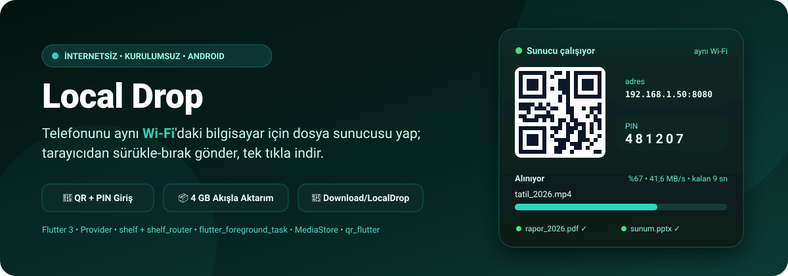
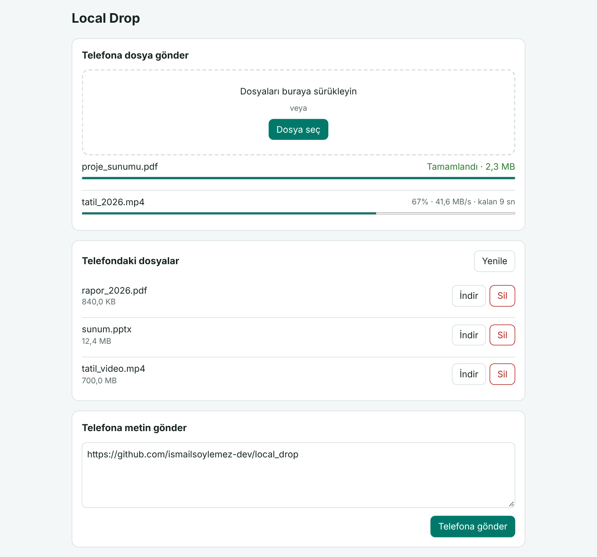
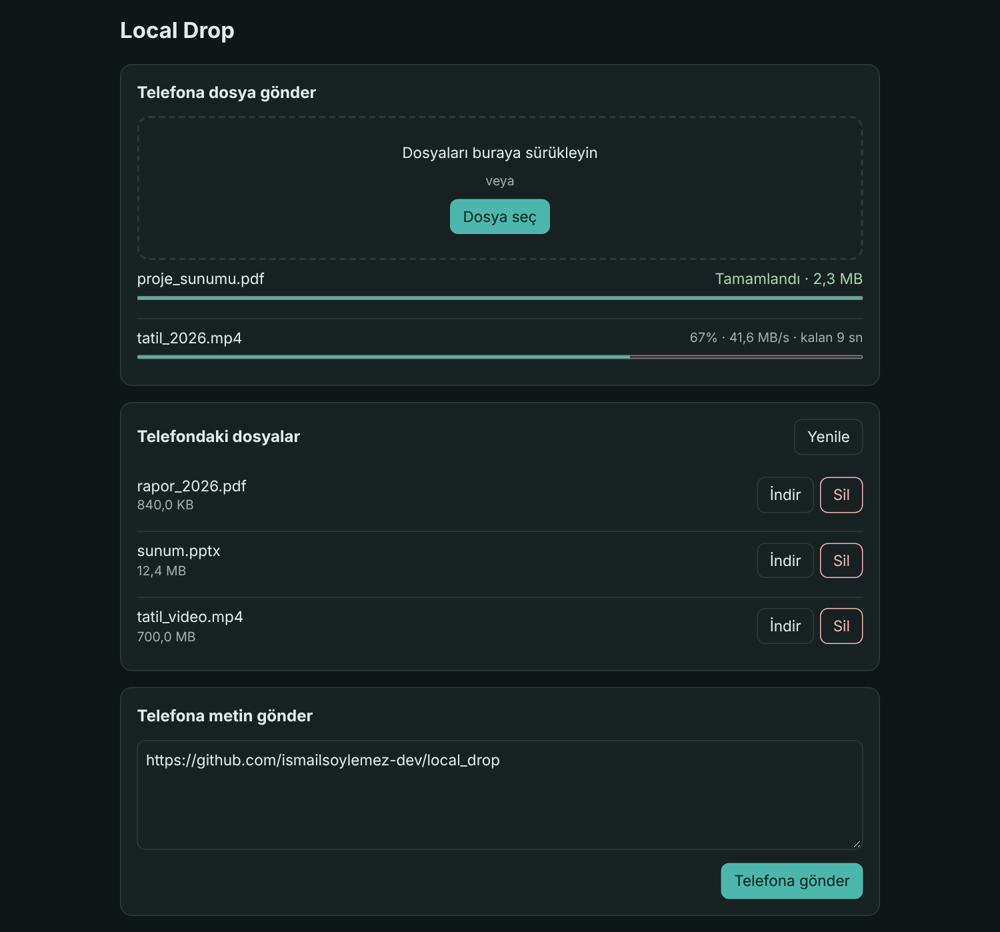
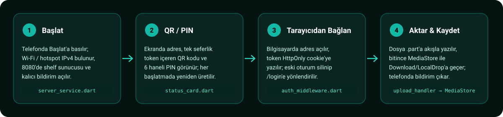
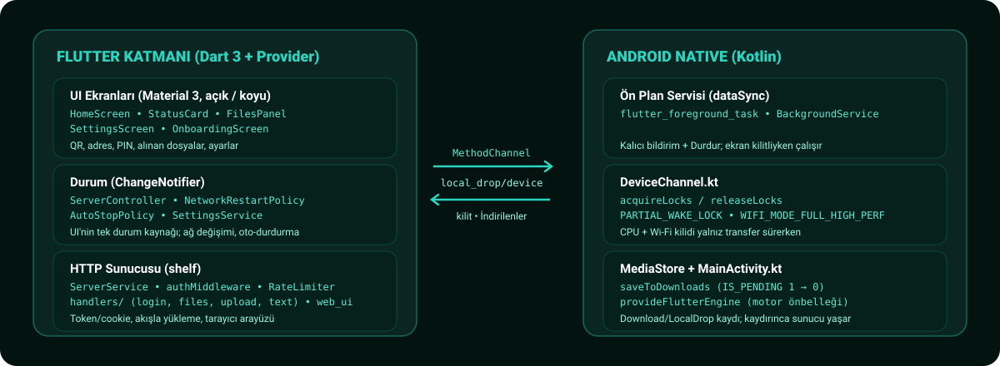
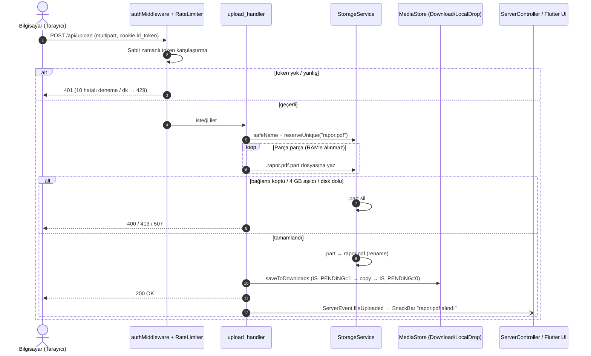

<p align="center">
  
</p>

<p align="center">
  
  
  
  
  
</p>

# Local Drop

**Local Drop**, Android telefonunu aynı Wi-Fi ağındaki bilgisayar için **geçici bir dosya sunucusuna** çeviren, tamamen yerel ağda (**internetsiz, bulutsuz, hesapsız**) çalışan bir dosya transfer uygulamasıdır. Bilgisayara hiçbir şey kurulmaz: tarayıcıdan QR'daki adrese girilir, dosyalar sürükle-bırak ile telefona gönderilir, telefondaki dosyalar tek tıkla indirilir.

- 📡 **Uygulama İçi HTTP Sunucusu (`shelf` + `shelf_router`):** Telefon, `0.0.0.0:8080` üzerinde dinleyen hafif bir HTTP sunucusu açar (port doluysa `8081 … 8090` arasında ilk boş port). Wi-Fi ve kişisel hotspot IPv4 adresi arayüz adıyla tespit edilir; mobil veri arayüzleri (`rmnet`, `ccmni`) elenir.
- 🔐 **Tek Seferlik Token + PIN Koruması:** Her başlatmada `Random.secure` ile 16 karakterlik token ve token'dan bağımsız 6 haneli PIN üretilir. Token QR koduna gömülür, ilk girişte `HttpOnly` + `SameSite=Strict` cookie'ye yazılır ve adres çubuğundan silinir. Karşılaştırma sabit zamanlıdır; yanlış denemeler IP başına dakikada 10 ile sınırlanır (`429` + `Retry-After`).
- 📦 **Akışla (Stream) Büyük Dosya Aktarımı:** Yüklemeler belleğe alınmadan doğrudan diske akar (tek dosya **4 GB**'a kadar). Veri önce gizli `.<ad>.part` dosyasına yazılır, tamamlanınca yeniden adlandırılır; bağlantı koparsa, limit aşılırsa veya disk dolarsa (`507`) yarım dosya otomatik silinir.
- 📂 **Atomik İndirilenler Kaydı (`MediaStore`):** Bilgisayardan gelen dosyalar `IS_PENDING=1 → 0` protokolüyle **`Download/LocalDrop`** klasörüne taşınır; Dosyalar ve Galeri uygulamalarında hemen görünür, yarım dosya hiçbir zaman görünmez. `MANAGE_EXTERNAL_STORAGE` istenmez.
- 🌙 **Arka Planda Kesintisiz Çalışma (`flutter_foreground_task`):** `dataSync` türünde ön plan servisi ve kalıcı bildirim (*Durdur* aksiyonu) sayesinde ekran kilitliyken veya uygulama kaydırılsa da sunucu çalışmaya devam eder. CPU ve Wi-Fi kilitleri (`PARTIAL_WAKE_LOCK`, `WIFI_MODE_FULL_HIGH_PERF`) yalnızca transfer sürerken tutulur.
- 🔄 **Ağ Değişimine ve Unutulmaya Dayanıklı:** Wi-Fi ağı değişince sunucu yeni IP, yeni token ve yeni QR ile kendini yeniden başlatır (aktif transfer bitene kadar bekler). Belirlenen süre (varsayılan 15 dk) transfer olmazsa sunucu otomatik kapanır.
- 📝 **İki Yönlü Paylaşım + Metin Gönderme:** Bilgisayardan telefona dosya ve metin (≤ 64 KB, tek dokunuşla panoya kopyalanır); telefondan bilgisayara *Bilgisayara gönder* ile seçilen dosyalar.

---

## Ekran Görünümleri

Sunucunun `GET /` ile bilgisayara verdiği, harici kaynak kullanmayan tek dosyalık tarayıcı arayüzü ([`lib/server/web_ui.dart`](lib/server/web_ui.dart)), örnek verilerle açık ve koyu temada:

<p align="center">
  
  
</p>

| Ekran | Öne Çıkan Özellikler |
|---|---|
| **Tarayıcı — Telefona dosya gönder** | Sürükle-bırak veya *Dosya seç* (çoklu), dosya başına ilerleme çubuğu, anlık hız (MB/s) ve kalan süre, hata durumunda *Tekrar dene*. |
| **Tarayıcı — Telefondaki dosyalar** | Ad ve boyut, *İndir*, satır içi onaylı *Sil* (*Emin misin?*), 5 sn'de bir otomatik yenileme (sekme görünürken). |
| **Tarayıcı — Telefona metin gönder** | Link, not veya kod; 64 KB sınırı anlık kontrol edilir. Oturum düşerse *Giriş yap* bandı çıkar. |
| **Telefon (`HomeScreen`)** | Sunucu durumu kartı (*Başlat / Durdur*), bağlantı QR kodu, kopyalanabilir adres, 6 haneli PIN, gelen metin bandı, alınan dosyalar listesi (dokun → aç, uzun bas → paylaş / sil), *Bilgisayara gönder*. |
| **Telefon (`SettingsScreen`)** | Kayıt yeri (*İndirilenler* / *Uygulama klasörü*), başlangıç portu, otomatik durdurma (*Kapalı*, 5–60 dk), tema (*Sistem / Açık / Koyu*). |
| **Telefon (`OnboardingScreen`)** | İlk açılışta 3 adım: aynı Wi-Fi, QR veya PIN ile giriş, güvenlik. |

Tarayıcının sistem temasını (`prefers-color-scheme`) otomatik izler; kullanıcı verisi yalnızca `textContent` ile basılır (`innerHTML` yok), her yanıtta `Content-Security-Policy` ve `X-Content-Type-Options: nosniff` başlıkları bulunur.

---

## Nasıl Çalışır?

<p align="center">
  
</p>

1. **Başlat (`ServerService`)** — Telefonda *Başlat*'a basılır; `NetworkService` Wi-Fi / hotspot IPv4 adresini bulur, `shelf_io.serve` ile `8080`'de (doluysa `8090`'a kadar) sunucu ve ön plan servisinin kalıcı bildirimi açılır.
2. **QR / PIN (`StatusCard`)** — Ekranda `http://192.168.1.50:8080/?t=<token>` adresi, tek seferlik token içeren QR kodu ve 6 haneli PIN görünür; ikisi de her başlatmada yeniden üretilir.
3. **Tarayıcıdan Bağlan (`authMiddleware`)** — Bilgisayarda adres açılır, token `HttpOnly` cookie'ye yazılır ve adres çubuğundan silinir; sunucu yeniden başlatılmışsa eski oturum silinip `/login`'e yönlendirilir.
4. **Aktar & Kaydet (`upload_handler` → `MediaStore`)** — Dosya `.part` dosyasına akışla yazılır, bitince `MediaStore` ile `Download/LocalDrop`'a geçer; telefonda *"x alındı"* bildirimi çıkar ve liste güncellenir.

---

## Teknik Mimari

<p align="center">
  
</p>

Uygulama tek bir Flutter süreci içinde **Flutter UI**, **uygulama içi HTTP sunucusu** ve **Android Native (Kotlin)** köprüsü olarak üç katmandan oluşur. UI yalnızca `ServerController`'ı (Provider `ChangeNotifier`) dinler; sunucu olayları `Stream<ServerEvent>` ile yukarı akar.



### Katman ve Sorumluluk Tablosu

| Katman | Dosya / Sınıf | Sorumluluk |
|---|---|---|
| **Flutter UI** | [`lib/app.dart`](lib/app.dart) | Material 3 tema (teal seed, açık/koyu), ilk açılışta tanıtım, sonra ana ekran. |
| **Flutter UI** | [`lib/ui/screens/home_screen.dart`](lib/ui/screens/home_screen.dart) | Durum kartı + dosya listesi, dar/geniş yerleşim, sunucu olaylarından `SnackBar`. |
| **Flutter UI** | [`lib/ui/widgets/status_card.dart`](lib/ui/widgets/status_card.dart) | *Başlat / Durdur*, QR (`qr_flutter`), adres kopyalama, PIN, aktif transferde durdurma onayı. |
| **Flutter UI** | [`lib/ui/widgets/files_panel.dart`](lib/ui/widgets/files_panel.dart) | Alınan dosyalar, aç (`open_filex`), paylaş (`share_plus`), sil, *Bilgisayara gönder* (`file_picker`). |
| **Flutter UI** | [`lib/ui/screens/settings_screen.dart`](lib/ui/screens/settings_screen.dart) | Kayıt yeri, port, otomatik durdurma, tema (`SharedPreferences`). |
| **State** | [`lib/state/server_controller.dart`](lib/state/server_controller.dart) | UI'nin tek durum kaynağı: `stopped → starting → running → error`, dosya listesi, gelen metin, ağ değişiminde yeniden başlatma, otomatik durdurma. |
| **Sunucu** | [`lib/services/server_service.dart`](lib/services/server_service.dart) | `shelf_io.serve` yaşam döngüsü, port aralığı, token + PIN üretimi, olay akışı. |
| **Sunucu** | [`lib/server/router.dart`](lib/server/router.dart) | İstek hattı: `securityHeaders → errorMiddleware → authMiddleware → shelf_router`. |
| **Sunucu** | [`lib/server/auth_middleware.dart`](lib/server/auth_middleware.dart) · [`rate_limiter.dart`](lib/server/rate_limiter.dart) | `?t=` / cookie doğrulama, eski cookie → `/login`, IP başına kayan pencereli deneme sınırı. |
| **Sunucu** | [`lib/server/handlers/`](lib/server/handlers/) | `login` (PIN), `files` (liste / indir / sil), `upload` (akışla yükleme, 413 / 507), `text` (≤ 64 KB). |
| **Depolama** | [`lib/services/storage_service.dart`](lib/services/storage_service.dart) | `safeName`, `resolve()` ile kök dışına çıkışı engelleme, `.part` yönetimi, eşzamanlı aynı ad için `reserveUnique`. |
| **Depolama** | [`lib/services/storage_target.dart`](lib/services/storage_target.dart) | Tamamlanan dosyayı ayara göre `Download/LocalDrop`'a taşıma. |
| **Arka Plan** | [`lib/services/background_service.dart`](lib/services/background_service.dart) | Ön plan servisi, kalıcı bildirim ve *Durdur* aksiyonu, Android 15 süre limiti. |
| **Android Native** | [`DeviceChannel.kt`](android/app/src/main/kotlin/com/example/local_drop/DeviceChannel.kt) | `local_drop/device` `MethodChannel`: CPU + Wi-Fi kilitleri, `MediaStore.Downloads` atomik kayıt, İndirilenler yolu. |
| **Android Native** | [`MainActivity.kt`](android/app/src/main/kotlin/com/example/local_drop/MainActivity.kt) | Flutter motorunu önbellekte tutar; uygulama kaydırılınca sunucu ölmez. |

### HTTP API

Tüm uçlar token ister (`?t=<token>` veya `ld_token` cookie'si); `/login` hariç.

| Yöntem | Yol | Açıklama |
|---|---|---|
| `GET` | `/` | Tarayıcı arayüzü (token yoksa veya eskiyse `/login`'e yönlendirir) |
| `GET` / `POST` | `/login` | PIN ile giriş, cookie ayarlar |
| `GET` | `/api/files` | Telefondaki dosyalar: `[{name, size, modified}]` |
| `POST` | `/api/upload` | `multipart/form-data` yükleme (tek dosya ≤ 4 GB) |
| `GET` | `/api/download/<ad>` | Dosyayı indir (`Content-Disposition: attachment`) |
| `DELETE` | `/api/files/<ad>` | Dosyayı sil |
| `POST` | `/api/text` | Telefona metin gönder (≤ 64 KB) |

```powershell
# Tarayıcı olmadan PowerShell ile deneme
$U = "http://192.168.1.50:8080"; $T = "<ekrandaki-token>"
curl.exe -s "$U/api/files?t=$T"
curl.exe -s -F "file=@C:\temp\test.zip" "$U/api/upload?t=$T"
curl.exe -s -o C:\temp\geri.zip "$U/api/download/test.zip?t=$T"
```

---

## Proje Dizin Yapısı

```text
local_drop/
├── android/app/src/main/
│   ├── AndroidManifest.xml            # İzinler, dataSync ön plan servisi
│   └── kotlin/com/example/local_drop/
│       ├── MainActivity.kt            # Motor önbelleği (kaydırınca sunucu yaşar)
│       └── DeviceChannel.kt           # Wake/Wi-Fi kilitleri + MediaStore kaydı
├── lib/
│   ├── main.dart                      # Servislerin kurulumu ve Provider ağacı
│   ├── app.dart                       # MaterialApp, tema, tanıtım / ana ekran
│   ├── core/                          # Sabitler, log, hata tipleri, safe_name, token/PIN, LAN IP seçimi
│   ├── server/
│   │   ├── router.dart                # İstek hattı ve route'lar
│   │   ├── auth_middleware.dart       # Token / cookie / login yönlendirmesi
│   │   ├── rate_limiter.dart          # IP başına deneme sınırı
│   │   ├── web_ui.dart                # Tek dosyalık tarayıcı arayüzü (HTML + CSS + JS)
│   │   └── handlers/                  # login, files, upload, text
│   ├── services/                      # network, server, storage, storage_target, background, device_channel, settings, file_actions
│   ├── state/                         # server_controller, network_restart_policy, auto_stop_policy
│   └── ui/
│       ├── screens/                   # home, settings, onboarding
│       └── widgets/                   # status_card, files_panel, text_banner
├── test/
│   ├── unit/                          # Saf fonksiyonlar ve politikalar
│   ├── server/                        # Handler testleri (ağ açmadan)
│   ├── integration/                   # Gerçek sunucu ile uçtan uca + kötüye kullanım
│   └── ui/                            # Widget testleri
└── docs/
    ├── PROJE_OZET.md                  # Mimari, kararlar, açık bulgular
    ├── FAZLAR.md                      # Geliştirme fazları ve test senaryoları
    ├── play_store.md                  # İzin gerekçeleri, Data Safety, yayın adımları
    └── images/                        # Diyagramlar ve ekran görüntüleri
```

---

## Kurulum ve Derleme

### Gereksinimler
- **Flutter SDK:** `^3.13.1` (Dart 3.13+)
- **Hedef Platform:** Android (`minSdk` / `targetSdk` = Flutter varsayılanı), `applicationId = com.ismail.localdrop`
- **Ağ:** Telefon ve bilgisayar aynı Wi-Fi ağında (veya bilgisayar telefonun hotspot'una bağlı)

### Komutlar

```powershell
# Depoyu klonlayın
git clone https://github.com/ismailsoylemez-dev/local_drop.git
cd local_drop

# Bağımlılıkları yükleyin
flutter pub get

# Statik kod analizi ve testleri çalıştırın
flutter analyze
flutter test

# Debug APK derlemesi
flutter build apk --debug

# Release APK / Play Store paketi
flutter build apk --release
flutter build appbundle --release
```

> `android/key.properties` yoksa release derlemesi debug anahtarıyla imzalanır (yalnızca kişisel kullanım için). Emülatör kendi sanal ağını (`10.0.2.x`) kullandığı için bilgisayardan erişilemez; gerçek cihazda test edin.

### Testler

**170'ten fazla test senaryosu** dört katmanda çalışır: saf birim testleri, ağ açmadan handler testleri, `127.0.0.1` üzerinde gerçek sunucuyla uçtan uca testler (50 MB akış yüklemesi bayt bayt doğrulama, kopan bağlantıda `.part` temizliği, 5 eşzamanlı yükleme, dolu port) ve kötüye kullanım testleri (`%2e%2e`, çift kodlama, mutlak yol, NUL baytı). `lib/services` + `lib/server` satır kapsaması **%85**.

---

## İzinler ve Gizlilik

- `INTERNET`, `ACCESS_NETWORK_STATE`, `ACCESS_WIFI_STATE`: Yerel ağda sunucu açmak ve Wi-Fi IP adresini bulmak için. Uygulama internete veya dış sunucuya **hiçbir istek atmaz**.
- `FOREGROUND_SERVICE` & `FOREGROUND_SERVICE_DATA_SYNC`: Uygulama arka plandayken veya ekran kilitliyken Android'in sunucuyu ve süren transferi sonlandırmaması için.
- `POST_NOTIFICATIONS`: Sunucu çalışırken kalıcı bildirimi (*Durdur* butonu) göstermek için; reddedilirse sunucu yine çalışır.
- `WAKE_LOCK`: Transfer sürerken CPU ve Wi-Fi'nin uykuya geçmemesi için; transfer bitince bırakılır.
- **İstenmeyen izinler:** `MANAGE_EXTERNAL_STORAGE`, `READ_EXTERNAL_STORAGE`, `READ_MEDIA_*`, konum ve açılışta başlatma izinleri kullanılmaz (bağımlılıklardan gelenler manifestte kaldırılmıştır).
- **Gizlilik:** Dosyalar ve metinler yalnızca aynı ağdaki iki cihaz arasında gider; hiçbir dış sunucuya telemetri veya analitik veri gönderilmez. Sunucu şifresiz HTTP kullandığı için yalnızca güvendiğiniz ağlarda (ev, kişisel hotspot) kullanın.
