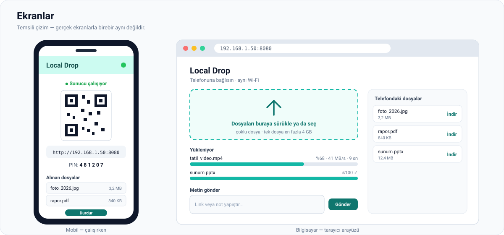
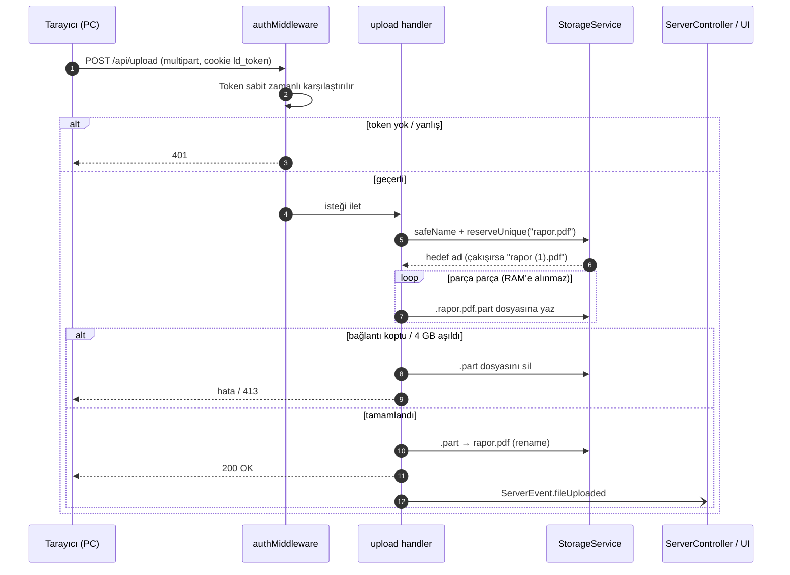

<p align="center">
  
</p>

<p align="center">
  
  
  
  
</p>

# Local Drop

**Local Drop**, Android telefonunu aynı Wi-Fi'deki bilgisayar için geçici bir dosya sunucusuna çevirir. Bilgisayarda hiçbir şey kurmazsın: tarayıcıdan telefondaki adrese girersin, dosyaları sürükleyip bırakırsın, telefondaki dosyaları indirirsin.

- 📵 **İnternet yok, bulut yok, hesap yok.** Veri yalnızca yerel ağda, iki cihaz arasında gider.
- 🔌 **Kablo yok, kurulum yok.** Bilgisayar tarafı sadece bir tarayıcı.
- 🔐 **Korumalı.** Her başlatmada yeni token üretilir; erişim QR'daki token ya da 6 haneli PIN ile.
- 📦 **Büyük dosyalar.** Yüklemeler RAM'e alınmadan doğrudan diske akar (tek dosya 4 GB'a kadar).

> **Neden?** Kendine WhatsApp'tan dosya göndermek, kablo aramak ya da bir dosya için buluta yükleyip indirmek yerine: *aç → okut → bırak.*

## Özellikler

| | Özellik | Ayrıntı |
|---|---|---|
| 💻 → 📱 | **Bilgisayardan telefona** | Tarayıcıda sürükle-bırak, çoklu dosya, dosya başına ilerleme çubuğu, hız ve kalan süre |
| 📱 → 💻 | **Telefondan bilgisayara** | Uygulamada *Bilgisayara gönder* ile dosya seç; tarayıcıdaki listeden indir |
| 📝 | **Metin gönderme** | Link veya notu tarayıcıdan telefona gönder; telefonda tek dokunuşla panoya kopyala |
| 📂 | **İndirilenler klasörü** | Gelen dosyalar `Download/LocalDrop` klasörüne kaydedilir; Dosyalar ve Galeri uygulamalarında görünür |
| 🔳 | **QR ile bağlanma** | Adres ve tek seferlik token QR'da; QR okutulamazsa 6 haneli PIN ile `/login` |
| 🌙 | **Arka planda çalışma** | Ön plan servisi + kalıcı bildirim (*Durdur* butonu); ekran kilitliyken de aktarım sürer |
| 🔄 | **Ağ değişimine dayanıklı** | Wi-Fi değişince sunucu yeni IP ve yeni QR ile kendini yeniden başlatır |
| ⏱️ | **Otomatik durdurma** | Belirlenen süre (varsayılan 15 dk) transfer olmazsa sunucu kapanır |
| ⚙️ | **Ayarlar** | Port, otomatik durdurma süresi, tema (açık/koyu/sistem); ilk açılışta 3 adımlı tanıtım |

---

## Nasıl çalışır?

<p align="center">
  
</p>

1. **Başlat** — Telefonda *Başlat*'a basarsın. Uygulama Wi-Fi (veya hotspot) IPv4 adresini bulur, mobil veri arayüzlerini eler ve `8080` portunda bir HTTP sunucusu açar. Port doluysa `8081 … 8090` arasında ilk boş olanı kullanır.
2. **QR / PIN** — Ekranda `http://192.168.1.50:8080/?t=<token>` adresi, bu adresin QR kodu ve 6 haneli bir PIN görünür. Token ve PIN her başlatmada yeniden üretilir.
3. **Tarayıcıdan bağlan** — Bilgisayarda adresi açarsın (ya da `/login` sayfasında PIN'i girersin). Token, `HttpOnly` ve `SameSite=Strict` bir cookie'ye yazılır; sonraki isteklerde tekrar sorulmaz.
4. **Aktar** — Dosyaları sürükle-bırak ile telefona yükle, telefondaki dosyaları listeden indir, ya da bir link veya notu metin olarak gönder. İşin bitince *Durdur*: sunucu kapanır, token geçersiz olur.

---

## Ekranlar

<p align="center">
  
</p>

> Görseller arayüzün **temsili çizimidir**; gerçek ekranlarla birebir aynı değildir.

---

## Mimari

<p align="center">
  
</p>

Uygulama tek bir Flutter süreci içinde iki parçadan oluşur:

| Katman | Dosya | Görev |
|---|---|---|
| Arayüz | `lib/ui/` | Durum, adres, PIN, Başlat/Durdur. Yalnızca `ServerController`'ı dinler. |
| Durum | `lib/state/server_controller.dart` | `ChangeNotifier` (Provider). `stopped → starting → running → error` durumlarının tek kaynağı. |
| Ağ | `lib/services/network_service.dart` | Wi-Fi/hotspot IPv4 tespiti, 3 sn'de bir yoklama, yalnızca değişimde yayın. |
| Sunucu | `lib/services/server_service.dart` | `shelf_io` ile `0.0.0.0` üzerinde dinler, token/PIN üretir, `ServerEvent` akışı yayınlar. |
| İstek hattı | `lib/server/` | `errorMiddleware → authMiddleware → shelf_router → handler` |
| Depolama | `lib/services/storage_service.dart` | Dosya adlarını temizler; tüm yollar `resolve()` üzerinden, kök klasör dışına çıkamaz. |
| Arka plan | `lib/services/background_service.dart` | Ön plan servisi ve bildirim; uygulama kaydırılsa da sunucu çalışır. |
| Native köprü | `android/.../DeviceChannel.kt` | CPU + Wi-Fi kilidi (yalnız transfer sürerken), MediaStore ile `Download/LocalDrop`'a kayıt. |

### Dosyalar nereye kaydedilir?

| Android sürümü | Konum | Uygulama ve tarayıcı listesinde |
|---|---|---|
| 11 ve üstü | `Dahili depolama/Download/LocalDrop/` | Görünür; açma, indirme ve silme buradan çalışır |
| 10 | `Dahili depolama/Download/LocalDrop/` | Görünmez; dosyaya Dosyalar uygulamasından ulaşılır |
| 9 ve altı | Uygulamaya özel klasör | Görünür (Dosyalar uygulamasında görünmez) |

Yükleme sürerken veri uygulama klasöründe gizli bir `.part` dosyasına yazılır. Yükleme bitince dosya MediaStore üzerinden `Download/LocalDrop`'a taşınır; yarım dosyalar hiçbir zaman İndirilenler'de görünmez. Depolama izni (`MANAGE_EXTERNAL_STORAGE`) istenmez. Varsayılan kayıt yeri İndirilenler'dir; istenirse Ayarlar'dan uygulama klasörüne çevrilebilir.

### Bir dosya yüklemesi adım adım



---

## Güvenlik

| Risk | Önlem |
|---|---|
| Aynı ağdaki başka biri erişirse | Her başlatmada 16 karakterlik rastgele token (`Random.secure`). Token'sız her istek `401`. |
| Token tahmini | Sabit zamanlı karşılaştırma. Yanlış token/PIN için IP başına dakikada 10 deneme; aşılırsa `429` + `Retry-After`. |
| Eski oturum | Sunucu yeniden başlayınca tarayıcıdaki eski cookie silinir ve `/login`'e yönlendirilir; hatalı deneme sayılmaz. |
| Path traversal (`../../`) | `safeName()` ayırıcıları ve `..`'yı temizler; `StorageService.resolve()` kök dışındaki yolu reddeder. |
| Yarım kalan yükleme | Veri önce `.part` dosyasına yazılır. Bağlantı koparsa silinir; tamamlanınca yeniden adlandırılır. |
| Bellek taşması | Yükleme ve indirme akış (stream) ile yapılır; dosya belleğe alınmaz. |
| Disk dolu | `507 Telefonda yer yok`; yarım dosya silinir. |
| XSS | Web arayüzünde kullanıcı verisi yalnızca `textContent` ile basılır; harici CDN yok; CSP başlığı. |
| Dışarıya veri sızması | Uygulama hiçbir dış sunucuya istek atmaz; analytics ve telemetri yok. |

> ⚠️ Sunucu şifresiz HTTP kullanır. Yalnızca güvendiğin ağlarda (ev, kişisel hotspot) kullan. Misafir ağlarda "client isolation" nedeniyle bağlantı zaten kurulamayabilir.

---

## HTTP API

Tüm uçlar token ister (`?t=<token>` veya `ld_token` cookie'si). `/login` hariç.

| Yöntem | Yol | Açıklama |
|---|---|---|
| `GET` | `/` | Web arayüzü (token yoksa `/login`'e yönlendirir) |
| `GET` / `POST` | `/login` | PIN ile giriş, cookie ayarlar |
| `GET` | `/api/files` | Telefondaki dosyalar: `[{name, size, modified}]` |
| `POST` | `/api/upload` | `multipart/form-data` yükleme |
| `GET` | `/api/download/<ad>` | Dosyayı indir (`Content-Disposition: attachment`) |
| `DELETE` | `/api/files/<ad>` | Dosyayı sil |
| `POST` | `/api/text` | Telefona metin gönder (≤ 64 KB) |

Tarayıcı olmadan, PowerShell ile denemek için:

```powershell
$U = "http://192.168.1.50:8080"; $T = "<ekrandaki-token>"
curl.exe -s "$U/api/files?t=$T"
curl.exe -s -F "file=@C:\temp\test.zip" "$U/api/upload?t=$T"
curl.exe -s -o C:\temp\geri.zip "$U/api/download/test.zip?t=$T"
```

---

## Çalıştırma

**Gereksinimler:** Flutter (Dart SDK ≥ 3.13), Android cihaz (minSdk Flutter varsayılanı), telefon ve bilgisayar aynı Wi-Fi'de.

```powershell
git clone https://github.com/ismailsoylemez-dev/local_drop.git
cd local_drop
flutter pub get
flutter run            # USB ile bağlı Android cihazda
```

**APK üretmek**

```powershell
flutter build apk --release        # build\app\outputs\flutter-apk\app-release.apk
flutter build appbundle --release  # Play Store için .aab
```

`android/key.properties` yoksa release derlemesi debug anahtarıyla imzalanır (yalnız kişisel kullanım için). Play Store hazırlığı: [`docs/play_store.md`](docs/play_store.md).

> Emülatör kendi sanal ağını kullandığı için (`10.0.2.x`) bilgisayardan erişilemez. Gerçek cihazda test et.

**Testler**

```powershell
flutter analyze
flutter test           # birim + handler + yerel entegrasyon (gerçek sunucu 127.0.0.1'de)
```

Entegrasyon testleri 50 MB akış yüklemesini bayt bayt doğrular; kopan bağlantıda `.part` kalmadığını, 5 eşzamanlı yüklemeyi, dolu portu ve kötüye kullanım isteklerini (`%2e%2e`, çift kodlama, mutlak yol, NUL) kontrol eder. `lib/services` + `lib/server` satır kapsaması %85.

---

## Yol haritası

| Faz | İçerik | Durum |
|---|---|---|
| F0 | Repo ve ajan dokümanları | ✅ |
| F1 | Flutter iskeleti, Provider | ✅ |
| F2 | Wi-Fi / hotspot IP tespiti | ✅ |
| F3 | HTTP sunucu, token/PIN, yükleme/indirme/silme | ✅ |
| F4 | Tarayıcı arayüzü (sürükle-bırak, ilerleme, metin) | ✅ |
| F5 | Mobil arayüz (QR, dosya listesi, telefondan gönderme) | ✅ |
| F6 | Arka planda çalışma (ön plan servisi), İndirilenler klasörü | ✅ |
| F7 | Rate limit, disk dolu, ağ değişiminde yeniden başlatma | ✅ |
| F8 | İkon, onboarding, ayarlar, yayın hazırlığı | ✅ |

Sıradaki: cihaz üzerinde uçtan uca doğrulamalar ([`docs/PROJE_OZET.md`](docs/PROJE_OZET.md) §9), gerçek ekran görüntüleri, Play Store yayını.

---

## Proje yapısı

```text
lib/
├── main.dart, app.dart
├── core/       sabitler, log, hata tipleri, safe_name, secrets (token/PIN), lan_ip, wakelock_policy
├── services/   network, server, storage, storage_target, background, device_channel, settings, file_actions
├── server/     router, auth_middleware, rate_limiter, web_ui, handlers/ (login, files, upload, text)
├── state/      server_controller, network_restart_policy, auto_stop_policy
└── ui/         screens/ (home, settings, onboarding), widgets/ (status_card, files_panel, text_banner)
test/
├── unit/        saf fonksiyonlar
├── server/      handler testleri (ağ açmadan)
├── integration/ gerçek sunucu ile uçtan uca
├── ui/          widget testleri
└── fakes/       sahte servisler
docs/
├── PROJE_OZET.md   güncel durum (tek giriş noktası)
├── FAZLAR.md       faz görevleri ve test senaryoları
├── AJAN_IS.md      geliştirme ajanı kuralları
├── play_store.md   izin gerekçeleri, Data Safety, yayın adımları
└── images/         README görselleri
```

## Geliştirme

Proje, 8 faz halinde bir yapay zekâ kodlama ajanıyla geliştirildi. Kurallar ve süreç:

- [`docs/AJAN_IS.md`](docs/AJAN_IS.md) — her işte geçerli kod, test, git ve token kuralları
- [`docs/FAZLAR.md`](docs/FAZLAR.md) — fazların kapsamı ve T1–T5 test senaryoları
- [`docs/PROJE_OZET.md`](docs/PROJE_OZET.md) — mimari, kararlar, açık bulgular, cihaz testleri
